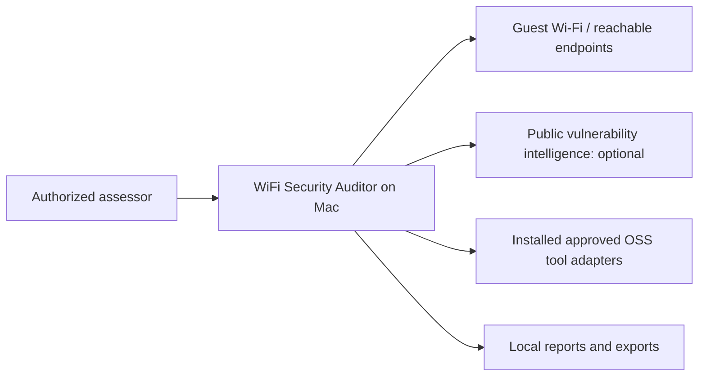
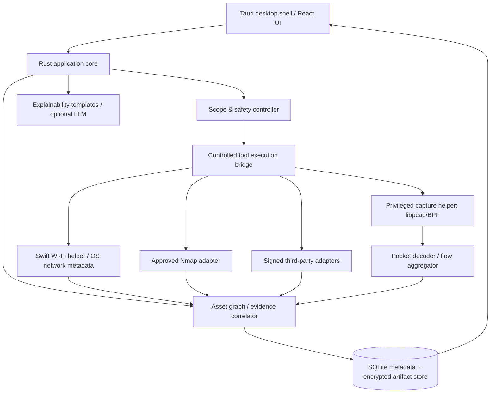

# System Architecture

## Architecture drivers
macOS-first; one guest-privileged vantage point; local-first/offline; transparent uncertainty; permissioned tests; dynamic plugins; high-volume network events; credible evidence and explainability.

## C4 L1 context

## C4 L2 containers

## Component responsibilities
| Component | Responsibility | Trust boundary |
|---|---|---|
| Tauri shell/React | Views, workflows, accessibility, visualization | No root/elevated privileges |
| Rust core | Sessions, job queue, state, schema validation, time correlation | Trusted app process |
| Scope/Policy controller | Authorization, immutable allowlists, rate limits, concurrency, kill switch | Enforcement independent of AI/plugin hints |
| Swift/CoreWLAN bridge | macOS Wi-Fi/interface metadata, platform capability checks | Local OS privacy permission |
| Capture helper | Minimal privileged packet capture and filtered stream to core | Separate, narrowly privileged process |
| Flow engine | Parse packets, aggregate direction/timeline/protocol, replay | Untrusted packet inputs |
| Graph/evidence | Observed vs inferred edges, claims, evidence chain, vulnerability correlation | Never assume whole network |
| Extension gateway | Registry, capability handshake, schema, signature/policy, bounded execution | Treat plugin outputs as untrusted |
| Knowledge/AI | Rule-grounded explanation and contextual education | LLM read-only by default |
| Storage | SQLite for structured records; PCAPNG/object artifacts separately | Encryption, retention, backup controls |

## Data flow: passive capture
1. User selects interface and consents. 2. Helper acquires BPF/libpcap capability. 3. Packet stream decoded to structured events. 4. Flow aggregator groups five-tuples with direction and byte counters. 5. Graph updates `FLOW_OBSERVED` edges only for seen flow. 6. UI charts update via bounded event channel. 7. Raw capture optional, metadata default. Backpressure and sampling must be explicit/recorded.

## Data flow: authorized scan
1. User creates signed-off scope/ROE. 2. Orchestrator issues scoped job envelope. 3. Controller validates target, port, checks, rate and time budget. 4. Adapter runs approved tool with process timeout; execution egress controls are applied where feasible. 5. Structured output parsed, mapped, schema-validated. 6. Finding and immutable evidence stored; graph enriched. 7. Report states confidence and limits.

## Network visibility model
- Wi-Fi association is observed by connected Mac; an AP/BSSID may not be same device as gateway.
- Local IP/route/DNS show configuration, not all reachable segments.
- Host discovery only verifies what responds via approved vantage point and method.
- BPF on a normal managed-mode interface generally captures packets that reach Mac; not a mirror of other clients.
- RF monitor mode cannot be assumed available while keeping same interface associated, especially across macOS versions/chipsets.
- VLAN IDs, full switch topology, all devices and intra-LAN traffic are **unknown** unless observed through an explicit other source (e.g. imported sensor logs).

## Deployment
- macOS app bundle with Tauri/Rust, React assets; signed/notarized distribution is a release goal.
- Tool adapters optional separately installed; advertise dependencies and versions.
- Permissioned capture helper installed only after clear consent; no root UI.
- Local single-user SQLite (MVP); optional remote connector in later version, explicitly labeled external sensor provenance.
- No centralized cloud requirement; asynchronous intel cache updates optional.

## Operational concerns
- Crash-safe sessions; idempotent event import; bounded captures; disk quota alarms; log redaction.
- ARM vs Intel, macOS permissions/system extensions and notarization require early compatibility spike.
- Package and review native dependencies/licensing per adapter.

## Dependency map
See [ADRs](adr/README.md), [data model](02-data-and-evidence-model.md), [plugin contracts](03-extension-and-standards.md), [security model](../security/02-product-security-and-privacy.md).
